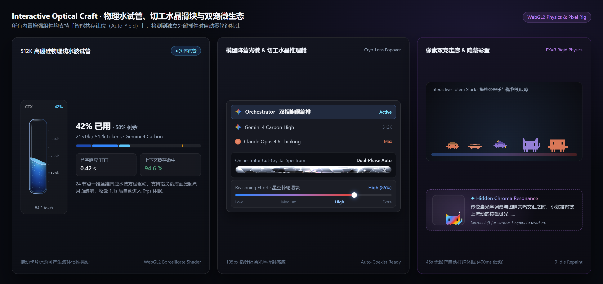
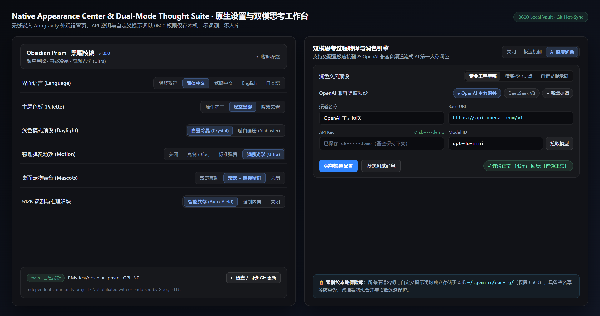

<div align="center">


# Obsidian Prism

**Optical UI, Spring Choreography & Dual-Mode Thought Suite for Antigravity**

Four Dark/Daylight Optical Palettes · Damped Spring Physics · 512K Shallow-Water Vial · Zero-Flicker Thought Translator

[**简体中文**](./README.md) · [**English**](./README.en.md) · [**Releases**](https://github.com/RMvdesi/obsidian-prism/releases) · [**Issues**](https://github.com/RMvdesi/obsidian-prism/issues)

<p>
  <a href="https://github.com/RMvdesi/obsidian-prism/releases"></a>
  
  <a href="https://github.com/RMvdesi/obsidian-prism/actions"></a>
  <a href="./LICENSE"></a>
  <a href="./NOTICE"></a>
</p>


</div>

> **Non-Affiliation & Trademark Disclaimer**
>
> **Obsidian Prism is an independent open-source project and is not affiliated with or endorsed by Google LLC.**
> References to “Antigravity” and “Google” are strictly for compatibility and descriptive purposes.

---

## ✨ Highlights

**Obsidian Prism** re-engineers the visual optics, compositor frame budget, live context telemetry, and chain-of-thought reading experience of the Antigravity desktop environment — without modifying host business logic or conflicting with external plugins:

- **🎨 Four Calibrated Optical Palettes**: Ships with two dark themes (**Obsidian Dark** & **Warm Charcoal**) and two high-contrast daylight presets (**Daylight Crystal** & **Warm Alabaster**), seamlessly tracking system/host light-dark switches.
- **⚡ GPU Compositor Offloading & True `0fps` Idle Sleep**: Eliminates persistent multi-layer `backdrop-filter` blur thrashing; clips the WebGL2 horizon aurora to the bottom `32%` viewport at `0.72x` resolution (`< 0.4%` GPU load) with strict **`0fps` sleep** when unfocused or set to `subtle`/`off`. Non-destructive element-level streaming animations keep React Fiber nodes 100% intact.
- **🧪 512K Physical Shallow-Water Vial & Cut-Crystal Effort Slider**: Simulates a 24-node 1D Saint-Venant shallow-water meniscus inside a borosilicate capsule alongside an Orchestrator cut-crystal spectrum bar. Built with **Smart Auto-Yield** — politely steps aside with zero duplicate polling whenever standalone external Pulse or Slider plugins are present.
- **🧠 Built-in Dual-Mode Thought Translator & Polisher**: Choose between zero-config **Instant Machine Translate** or **OpenAI-Compatible Streaming AI Polish** (multi-profile switching, live `GET /v1/models` discovery, and latency testing). API keys and custom prompts are stored strictly locally in `~/.gemini/config/` (`0600` permissions) — zero telemetry, never committed to Git.
- **🦀 Pixel Mascot Stage**: Interactive `Clawd` & cat companions with rigid-body spacing, leapfrogging, multi-tier drag-and-drop stacking, and automatic low-power dozing.

---

## 🖼️ Visual Showcase

### 1. Dual Dark × Dual Daylight Optical Matrix
Every palette features bespoke surface elevation tokens and a dedicated WebGL2 dichroic horizon shader:

<p align="center">
  
</p>

| Optical Preset | Config Key | Sidebar | Canvas | Optical Signature |
| :--- | :--- | :--- | :--- | :--- |
| **Obsidian Dark** | `palette: "obsidian"` | `#09090B` | `#0E0E11` | Deep obsidian crystal with 4-color aurora breathing |
| **Warm Charcoal** | `palette: "warm"` | `#10100F` | `#141413` | Editorial warm charcoal with subtle amber-terracotta glow |
| **Daylight Crystal** | `lightPreset: "crystal"` | `#E8EEF6` | `#F4F7FB` | Crisp glacier porcelain, royal cobalt ink wash & dual-layer elevation |
| **Warm Alabaster** | `lightPreset: "alabaster"` | `#EBE6DC` | `#F6F4EE` | Warm linen paper texture with jewel dichroic watercolor wash |

---

### 2. Shallow-Water Vial · Effort Slider · Pixel Mascots
Interactive context usage meniscus inside the **512K Context Vial**, cursor-reactive optical rim highlights, and rigid-body stackable pixel mascots on the composer bar:

<p align="center">
  
</p>

---

### 3. Native Appearance Center & Zero-Fingerprint Thought Workbench
Embedded directly into **Antigravity → Settings → Appearance**, supporting 5 UI languages (`zh-CN`, `zh-TW`, `yue`, `en`, `ja`), 4 damped-spring motion tiers, one-click Git `pull --ff-only` hot-reload, and local-only multi-profile AI thought polishing:

<p align="center">
  
</p>

---

## 🚀 Quick Start

Obsidian Prism offers both **standalone GUI installers** (zero Node.js dependency) and **native Antigravity plugin deployment**, persisting cleanly across reloads and restarts:

### Option A: Standalone GUI Installer (Recommended for Most Users)
Download the latest binary from [**GitHub Releases**](https://github.com/RMvdesi/obsidian-prism/releases):
1. **Windows**: Run `obsidian-prism-installer.exe` for one-click injection and silent background watcher setup (also supports one-click clean uninstall).
2. **macOS (Apple Silicon & Intel Universal)**: Open `Obsidian-Prism-macOS-universal.dmg` and launch `Obsidian Prism.app` to install and configure the LaunchAgent watcher.

### Option B: Native Plugin Deployment from Source (Recommended for Developers)
```bash
git clone https://github.com/RMvdesi/obsidian-prism.git
cd obsidian-prism

# Sync to ~/.gemini/config/plugins/obsidian-prism and attach to live windows immediately
npm run install:plugin
```
Then open **Settings → Appearance** in Antigravity to expand the **Obsidian Prism** control section.

<details>
<summary><strong>🛠️ CLI Utilities & Repository Layout (Click to expand)</strong></summary>

```bash
npm run inject           # One-shot live injection into running Antigravity windows
npm run remove           # Cleanly remove all styles/widgets and restore stock UI
npm run clean:legacy     # Safely strip legacy blocks from historical app.asar archives
npm test                 # Run the full cross-module security & regression test suite
npm run build:installer  # Build standalone Windows installer (.exe)
npm run build:macos      # Build standalone macOS Universal bundle (.dmg)
```
</details>

---

## ⚖️ License, Derivative Rules & Citation

### 1. Open-Source License & Mandatory Attribution (`GPL-3.0` + `NOTICE`)
**Obsidian Prism** (`Copyright (C) 2026 RMvdesi`) is licensed under the **[GNU General Public License v3.0 (`GPL-3.0-only`)](./LICENSE)** with mandatory Section 7 attribution terms in **[`NOTICE`](./NOTICE)**.

Any fork, modification, port, or redistribution must comply with all three requirements:
1. **Same-License Copyleft**: Any derivative plugin, theme bundle, or installer incorporating code from Obsidian Prism must be distributed as free software under **`GPL-3.0`** with full source code disclosed. Proprietary bundling, obfuscation lock-in, or commercial closed-source resale is strictly prohibited.
2. **Preserve Attribution Chain**: Retain [`LICENSE`](./LICENSE), [`NOTICE`](./NOTICE), and [`THIRD_PARTY_NOTICES.md`](./THIRD_PARTY_NOTICES.md) intact, and keep visible credit linking back to `@RMvdesi` and `RMvdesi/obsidian-prism` in your README and settings UI.
3. **Mark Modifications & Non-Endorsement**: Clearly document modification dates and changes in altered files, and do not distribute modified forks under the unmodified `Obsidian Prism` name as if they were official releases.

#### Downstream Attribution Snippet
```markdown
> Built upon [Obsidian Prism](https://github.com/RMvdesi/obsidian-prism) by [@RMvdesi](https://github.com/RMvdesi), licensed under [GPL-3.0](https://www.gnu.org/licenses/gpl-3.0.html). Upstream component notices are preserved in `NOTICE` and `THIRD_PARTY_NOTICES.md`.
```

#### Citation (`CITATION.cff` / BibTeX)
```bibtex
@software{rmvdesi_obsidian_prism_2026,
  author       = {RMvdesi},
  title        = {{Obsidian Prism: Optical UI, Spring Choreography & Dual-Mode Thought Suite for Antigravity}},
  year         = {2026},
  version      = {1.0.0},
  license      = {GPL-3.0-only},
  url          = {https://github.com/RMvdesi/obsidian-prism}
}
```

---

### 2. Upstream Open-Source Credits

Absorbed third-party components were originally released under the permissive **MIT License** (upward-compatible with GPL-3.0), with full copyright and license texts preserved in [`THIRD_PARTY_NOTICES.md`](./THIRD_PARTY_NOTICES.md):

1. **[0DNANCY/agy-claude-style](https://github.com/0DNANCY/agy-claude-style)** — `MIT License`, `Copyright (c) 2026 0DNANCY` (Optical theme foundation, spring choreography, WebGL2 aurora/glyph wavefield, pixel mascot rig, and zero-dependency bundler).
2. **[ATtacK030130/antigrative-dashboard](https://github.com/ATtacK030130/antigrative-dashboard)** — `MIT License`, `Copyright (c) 2026 AG Pulse contributors` (Absorbed in `vendor/pulse-dashboard/` for live token throughput, cache hit rate, and context telemetry).
3. **[LLYSH-HANNARI/antigravity-Codex-Claude-effort-slider](https://github.com/LLYSH-HANNARI/antigravity-Codex-Claude-effort-slider)** — `MIT License`, `Copyright (c) 2026 LLYSH-HANNARI` (Absorbed in `vendor/effort-slider/` for reasoning effort slider and smart coexistence).
4. **[Nwflower/dsh-claude-style](https://github.com/Nwflower/dsh-claude-style)** — Studio editorial typography, clean composer framing, and warm alabaster palette inspiration.
5. **[Microqian2th/dsh-codex-effort-slider](https://github.com/Microqian2th/dsh-codex-effort-slider)** — Stardust energy track, hysteresis ratchet detents, and damped motion curve inspiration.
6. **[mobius/dsh-performance-slider](https://github.com/mobius/dsh-performance-slider)** — Performance tier slider interaction paradigm and live visual feedback inspiration.
7. **[claudenoshujin/claude-web](https://github.com/claudenoshujin/claude-web)** (by `lulu`) — *Mascot Pile & Micro-Ecology Interaction Inspiration* (Clean-room independent physics implementation).
