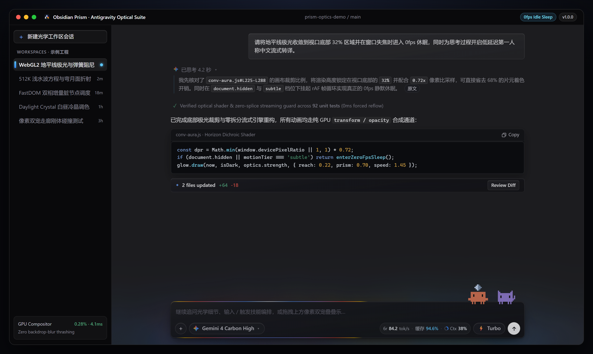
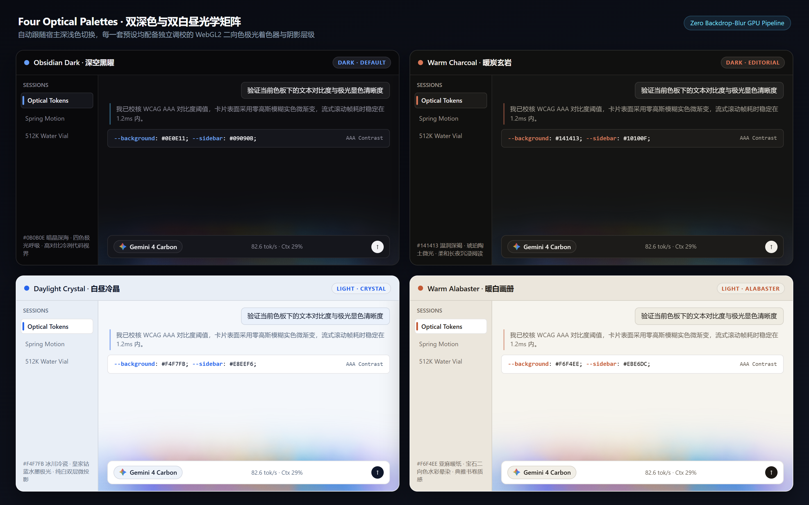

<div align="center">


# Obsidian Prism

**Modular Optical UI, Workbench Enhancements, Omni File Viewer, Quota Telemetry & Thought Translator for Antigravity**

Four Dark/Daylight Themes · Side-Pane Browser & Streaming File Viewer · Dual-Window Quota Telemetry · Dual-Mode Thought Translator

[**简体中文**](./README.md) · [**English**](./README.en.md) · [**Changelog**](./CHANGELOG.md) · [**Releases**](https://github.com/RMvdesi/obsidian-prism/releases) · [**Issues**](https://github.com/RMvdesi/obsidian-prism/issues)

<p>
  <a href="https://github.com/RMvdesi/obsidian-prism/releases"></a>
  
  
  <a href="https://github.com/RMvdesi/obsidian-prism/actions"></a>
  <a href="./LICENSE"></a>
  <a href="./NOTICE"></a>
</p>



</div>

> **Non-Affiliation & Trademark Disclaimer**
>
> **Obsidian Prism is an independent open-source project and is not affiliated with or endorsed by Google LLC.**
> References to “Antigravity” and “Google” are strictly for compatibility and descriptive purposes.

---

## Key Features

**Obsidian Prism (`v1.0.1`)** provides dark/daylight themes, host workbench enhancements, a built-in side-pane browser and streaming multi-format file viewer, live quota telemetry, and chain-of-thought translation for the Antigravity desktop client through a native Sidecar plugin architecture — without altering host business logic or conflicting with external plugins:

- **Four Dark/Daylight Themes & Fine-Grained Controls**: Includes two dark palettes (**Obsidian Dark** & **Warm Charcoal**) and two daylight presets (**Daylight Crystal** & **Warm Alabaster**) with automatic host light/dark tracking, plus 5 accent tones (Follow Model, Cobalt, Iris, Amber, and Graphite Monochrome `mono`), 3 corner radius scales, 4 code monospace font stacks with ligature toggle, and ambient glow intensity controls.
- **300Hz Split-Rate Pipeline, 5-Step Ink Streaming & `0fps` Semantic Afterglow**: Removes persistent multi-layer `backdrop-filter` blur passes; renders streaming responses with a `CSS.highlights`-based **5-step ink fade-in** (zero wrapper nodes, zero forced layout reflow, maintaining smooth high-refresh frame pacing even in `34k+`-node long sessions); caps steady-state background aurora rendering to `~30fps` on 300Hz displays and enters `0fps` idle sleep `1.2s` after activity ends. Provides non-intrusive three-state semantic edge cues (awaiting user decision, error halted, and background long-task completion) that freeze into `0fps` static snapshots.
- **Host Workbench & Sidecar Integration**: Synchronizes 24 theme color variables in real time to `plugin://*` Sidecar `iframe` panels (Swarm, Model Hub, Pulse, etc.) via the host `preload` `postMessage` protocol to prevent white flashes; adds sticky headers to Markdown and Artifact code blocks with manual fold/unfold controls for completed blocks (`>= 48` lines, never auto-truncated, with scroll-anchor compensation); enhances the left conversation rail with chapter tick styles, on-hover prompt outline filtering, historical step folding, and `Alt+↑` / `Alt+↓` turn navigation; unifies terminal and background task surfaces with four-theme Console Well styling.
- **Omni Side-Pane Browser, Context Menu & Streaming File Viewer**: Configurable via `omniModule` (`"on" | "off"`) and `linkTarget` (`"builtin" | "external"`). Uses `CSS.highlights` (Custom Highlight API) for zero-DOM-mutation activation of bare URLs, `localhost` ports, and local file paths in chat and terminal output without splitting host React text nodes; left-clicking web links opens them in the right side-pane built-in browser by default (`Ctrl/Cmd+Click` toggles the system browser). Preserves **zero hover-popup clutter** during reading — actions appear strictly on right-click (`contextmenu`) over links, file pills, Artifact cards, or Mermaid diagrams (copy absolute/relative paths, reveal in folder, insert as `@mention` into composer, open in side-pane/external browser, or zoom diagrams). Backed by a loopback-only (`127.0.0.1`) HTTP `206 Range` streaming gateway supporting frame-stepped large video inspection, millisecond audio waveform markers, checkerboard SVG/transparent-image zoom & PNG export, responsive local HTML sandboxes, PDF viewing, frozen-header `CSV/TSV/JSONL` search/sorting, and `TTF/OTF/WOFF2` font specimen waterfalls.
- **Defense-in-Depth Security & Local Isolation**: Enforces top-level main-frame verification on all privileged `__agPrism*` CDP bindings (rejecting sub-`<iframe>` RPC calls); hardens the loopback streaming gateway with `Host` and cross-site request checks, `realpath` blocking of sensitive credential files (`.env*`, `.ssh`, private keys, and local token configs), and remote UNC path blocking; isolates local HTML previews with per-directory `HMAC-SHA256` read-only sub-tokens and restricted `sandbox` attributes (without `allow-same-origin`), while disabling upstream redirects and blocking cloud-metadata/unsafe ports in thought translation requests.
- **Dual-Window Quota Telemetry & 512K Context Vial**: Aligns `vendor/pulse-dashboard/` with upstream [`ATtacK030130/antigrative-dashboard`](https://github.com/ATtacK030130/antigrative-dashboard) `v0.9.1` (MIT), supporting **5-hour and weekly quota pool tracking with linear depletion forecasts**, **main session vs. Swarm/subagent token attribution**, **cache hit rate** metrics, and CDP process-lineage multi-instance discovery. Exposes Overview, Trends, and Quotas views with workspace filtering on the Studio home dashboard, stores telemetry in an isolated sidecar directory, and yields automatically when standalone external plugins are active.
- **Dual-Mode Thought Translator**: Supports zero-config **Machine Translation** and **OpenAI-Compatible Streaming Translation**, allowing keyless local endpoints (`localhost` / LAN Ollama, LM Studio, vLLM without requiring an API key); safely restores `file://` source paths and `#L` line-number jump pills under a strict `file://`-only protocol allowlist; adds a concurrency-limited (`max = 3`) viewport-priority queue, per-block retry/re-translate controls, **Immersive vs. Stacked Bilingual** view modes, and cache management. API keys and custom prompts are stored locally in `~/.gemini/config/` (`0600` permissions).
- **Microkernel Architecture & Sub-10ms Config Sync**: Splits the runtime into a lean `ui-runtime.js` microkernel and 6 focused controller modules compiled with a cross-module shared string pool (`< 680 KB` static main bundle, with the Omni client delivered on a dedicated second channel). Covers 26 validated configuration keys with `< 10 ms` single-flight incremental `refreshConfig` broadcast, three scene presets, categorized sub-tabs, and API-key-sanitized JSON export/import.

---

## Visual Overview

### 1. Dual Dark × Dual Daylight Themes
Each theme defines surface elevation tokens, border contrast, and matching WebGL2 horizon shader color temperature:

<p align="center">
  
</p>

| Theme Preset | Config Key | Sidebar | Canvas | Notes |
| :--- | :--- | :--- | :--- | :--- |
| **Obsidian Dark** | `palette: "obsidian"` | `#09090B` | `#0E0E11` | Cool dark slate palette tuned for high-contrast code reading |
| **Warm Charcoal** | `palette: "warm"` | `#10100F` | `#141413` | Warm charcoal dark palette with reduced blue-light glare |
| **Daylight Crystal** | `lightPreset: "crystal"` | `#E8EEF6` | `#F4F7FB` | Cool slate-blue sidebar paired with a bright workspace canvas |
| **Warm Alabaster** | `lightPreset: "alabaster"` | `#EBE6DC` | `#F6F4EE` | Warm paper-tinted daylight palette with softer contrast |

---

### 2. Context Vial · Effort Slider · Pixel Mascots
Displays live 512K context usage inside a compact 1D shallow-water vial — **click to open the optical quota & breakdown popover** (showing context slice breakdown, main/subagent token split, and 5h/weekly depletion forecasts) — alongside a reasoning effort slider inside the model selector menu and optional pixel mascots (`Clawd` & cat) that sleep automatically when idle:

<p align="center">
  
</p>

---

### 3. Appearance Control Center & Thought Translator Settings
Integrated into **Antigravity → Settings → Appearance**, providing 5 UI languages (`zh-CN`, `zh-TW`, `yue`, `en`, `ja`), 26 validated configuration keys (including `omniModule` for file viewer & context menu and `linkTarget` for default web link target), three scene presets (Full Visuals / Deep Focus / Silent Eco), sanitized JSON config backup/restore, one-click Git `pull --ff-only` updates, and multi-profile thought translation settings:

<p align="center">
  
</p>

---

## Quick Start

Obsidian Prism provides **standalone GUI installers** (no Node.js required) and **source-based native plugin deployment**, persisting across window reloads and client restarts:

### Option A: Standalone GUI Installer (Recommended · Zero External Dependencies, No Node.js Required)
Download the latest installer directly below (or browse all versions on [**GitHub Releases**](https://github.com/RMvdesi/obsidian-prism/releases)):
1. **Windows (`x64`)**: Download [**`obsidian-prism-installer.exe`**](https://github.com/RMvdesi/obsidian-prism/releases/latest/download/obsidian-prism-installer.exe) and run it. With zero external runtime dependencies (no system Node.js installation needed), it deploys the complete native plugin to `~/.gemini/config/plugins/obsidian-prism`, reuses the bundled Antigravity runtime headlessly to activate all five Sidecar channels immediately, and registers background startup protection (re-run the same `.exe` anytime for a one-click clean uninstall).
2. **macOS (`Apple Silicon & Intel Universal`)**: Download [**`Obsidian-Prism-macOS-universal.dmg`**](https://github.com/RMvdesi/obsidian-prism/releases/latest/download/Obsidian-Prism-macOS-universal.dmg), mount the disk image, drag `Obsidian Prism.app` into `/Applications`, and **double-click `Obsidian Prism.app` once** to complete native five-channel Sidecar deployment and `LaunchAgent` setup (the same app also provides one-click clean uninstall).

> **First-Launch OS Security Prompt (Open-Source Build Note)**
> - **Windows SmartScreen**: Because the installer is built independently without a commercial EV code-signing certificate, if Windows shows *"Windows protected your PC"*, click **More info → Run anyway**.
> - **macOS 15+ Gatekeeper**: Because the Universal `.app` uses open-source ad-hoc signing (not notarized under a paid Apple Developer ID), if macOS blocks first launch due to browser quarantine, open **System Settings → Privacy & Security**, scroll down and click **Open Anyway**, or strip the quarantine attribute once in Terminal before launching:
>   ```bash
>   xattr -cr "/Applications/Obsidian Prism.app"
>   ```

### Option B: Native Plugin Deployment from Source (Recommended for Developers)
```bash
git clone https://github.com/RMvdesi/obsidian-prism.git
cd obsidian-prism

# Deploy to ~/.gemini/config/plugins/obsidian-prism and attach to running windows
npm run install:plugin
```
Then open **Settings → Appearance** in Antigravity to expand the **Obsidian Prism** control panel.

<details>
<summary><strong>CLI Utilities & Repository Structure (Click to expand)</strong></summary>

#### Common CLI Commands
```bash
npm run inject           # One-shot live injection into running Antigravity windows
npm run remove           # Cleanly remove all styles/widgets and restore stock UI
npm run clean:legacy     # Strip legacy blocks from historical app.asar archives
npm test                 # Run cross-module security, bundle & regression tests
npm run build:installer  # Build standalone Windows installer (.exe)
npm run build:macos      # Build standalone macOS Universal bundle (.dmg)
```

#### Core Repository Layout
```text
obsidian-prism/
├── plugin.json                         # Antigravity native plugin manifest (obsidian-prism@1.0.1)
├── LICENSE / NOTICE / CITATION.cff     # GPL-3.0 license, attribution terms & citation metadata
├── THIRD_PARTY_NOTICES.md              # Preserved copyright & license notices for MIT upstreams
├── assets/                             # Vector plugin icon & documentation screenshots
├── cdp.js / inject.js / remove.js      # Shared-pool bundle compiler (<680KB), dual-channel attach & removal
├── style.css                           # Four themes, accent/corner tokens & workbench surface styles
├── i18n-locales.js / i18n-core.js      # 5-language localization tables (zh-CN/zh-TW/yue/en/ja)
├── motion-engine.js / animated-icons.js# 4-tier damped spring physics & animated UI icons
├── ripple-core.js / conv-aura.js       # 300Hz split-rate WebGL2 horizon shader & 0fps semantic cues
├── smooth-caret.js / dual-mascot-rig.js# Read/write-separated caret tracking & pixel mascot rig
├── usage-core.js / vial-core.js        # Quota forecast functions & 512K shallow-water vial renderer
├── pulse-vial-bridge.js                # Context slice breakdown & 5h/weekly quota popover bridge
├── settings-panel.js                   # Settings UI (26 keys, scene presets, sanitized JSON backup)
├── home-studio-panel.js                # Controller 1: Studio home dashboard (Overview/Trends/Quotas)
├── home-ripple-host.js                 # Controller 2: Home glyph ripple matrix host controller
├── model-glyph-crystal.js              # Controller 3: Model glyph & WebGL2 prism bar controller
├── stream-choreography.js              # Controller 4: CSS.highlights 5-step ink fade & table row throttle
├── prism-rim-canvas.js                 # Controller 5: Cursor-reactive border highlight controller
├── host-workbench-enhancer.js          # Controller 6: Sidecar theme bridge, code fold & rail outline
├── ui-runtime.js                       # Frontend microkernel: fast config sync & lifecycle orchestration
├── sidecars/daemon/                    # Multi-channel native daemon (settings/metrics/usage/repo/thought/omni)
├── vendor/                             # Telemetry (v0.9.1), effort-slider, thought-translator & omni-viewer
└── installer/ & tools/                 # Windows (C#) / macOS (Swift) native-plugin installers & scripts
```
</details>

---

## License, Derivative Rules & Citation

### 1. Open-Source License & Mandatory Attribution (`GPL-3.0-only` + `NOTICE`)
**Obsidian Prism** (`Copyright (C) 2026 RMvdesi`) is licensed under the **[GNU General Public License v3.0 (`GPL-3.0-only`)](./LICENSE)** with mandatory Section 7 attribution terms in **[`NOTICE`](./NOTICE)**.

Any fork, modification, port, or redistribution must comply with all three requirements:
1. **Same-License Copyleft**: Any derivative plugin, theme bundle, or installer incorporating code from Obsidian Prism must be distributed under **`GPL-3.0`** with complete corresponding source code disclosed. Proprietary bundling, obfuscation lock-in, or closed-source commercial resale is prohibited.
2. **Preserve Attribution Chain**: Retain [`LICENSE`](./LICENSE), [`NOTICE`](./NOTICE), and [`THIRD_PARTY_NOTICES.md`](./THIRD_PARTY_NOTICES.md) intact, and keep visible credit linking back to `@RMvdesi` and `RMvdesi/obsidian-prism` in your README and settings UI.
3. **Mark Modifications & Non-Endorsement**: Document modification dates and summaries in altered files, and do not distribute modified forks under the unmodified `Obsidian Prism` name as official releases without written permission.

#### Downstream Attribution Snippet
```markdown
> Built upon [Obsidian Prism](https://github.com/RMvdesi/obsidian-prism) by [@RMvdesi](https://github.com/RMvdesi), licensed under [GPL-3.0](https://www.gnu.org/licenses/gpl-3.0.html). Upstream component notices are preserved in `NOTICE` and `THIRD_PARTY_NOTICES.md`.
```

#### Citation (`CITATION.cff` / BibTeX)
```bibtex
@software{rmvdesi_obsidian_prism_2026,
  author       = {RMvdesi},
  title        = {{Obsidian Prism: Modular Optical UI, Workbench Enhancements, Omni File Viewer, Quota Telemetry & Thought Translator for Antigravity}},
  year         = {2026},
  version      = {1.0.1},
  license      = {GPL-3.0-only},
  url          = {https://github.com/RMvdesi/obsidian-prism}
}
```

---

### 2. Upstream Open-Source Credits

Absorbed and adapted third-party components were originally released under the **MIT License** (compatible with `GPL-3.0-only`), with full copyright and permission notices preserved in [`THIRD_PARTY_NOTICES.md`](./THIRD_PARTY_NOTICES.md):

1. **[0DNANCY/agy-claude-style](https://github.com/0DNANCY/agy-claude-style)** — `MIT License`, `Copyright (c) 2026 0DNANCY` (Base palette tokens, spring physics foundation, WebGL2 horizon/glyph wavefield, pixel mascot foundation, and initial bundler).
2. **[ATtacK030130/antigrative-dashboard](https://github.com/ATtacK030130/antigrative-dashboard)** (`v0.9.1`) — `MIT License`, `Copyright (c) 2026 AG Pulse contributors` (Absorbed and adapted in `vendor/pulse-dashboard/` for live token throughput, cache hit rate, 5h/weekly quota forecasting, main/subagent token attribution, and CDP process-lineage discovery).
3. **[LLYSH-HANNARI/antigravity-Codex-Claude-effort-slider](https://github.com/LLYSH-HANNARI/antigravity-Codex-Claude-effort-slider)** — `MIT License`, `Copyright (c) 2026 LLYSH-HANNARI` (Absorbed and adapted in `vendor/effort-slider/` for model-menu reasoning effort slider and smart coexistence yielding).
4. **[Nwflower/dsh-claude-style](https://github.com/Nwflower/dsh-claude-style)** — Minimalist Studio layout, composer framing, and warm alabaster daylight palette reference.
5. **[Microqian2th/dsh-codex-effort-slider](https://github.com/Microqian2th/dsh-codex-effort-slider)** — Detent track snapping, hysteresis thresholds, and damped motion curve reference.
6. **[mobius/dsh-performance-slider](https://github.com/mobius/dsh-performance-slider)** — Performance tier slider interaction and live visual feedback reference.
7. **[claudenoshujin/claude-web](https://github.com/claudenoshujin/claude-web)** (by `lulu`) — Mascot stacking interaction reference (clean-room independent physics implementation).
