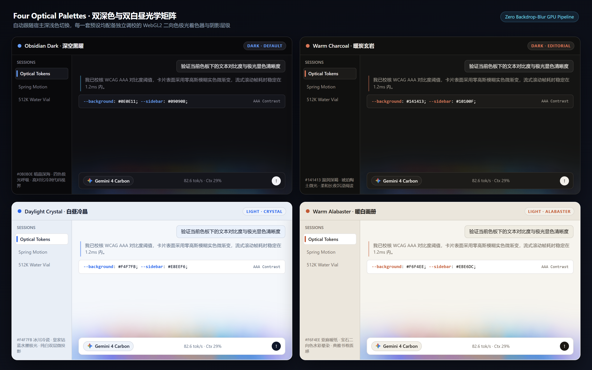
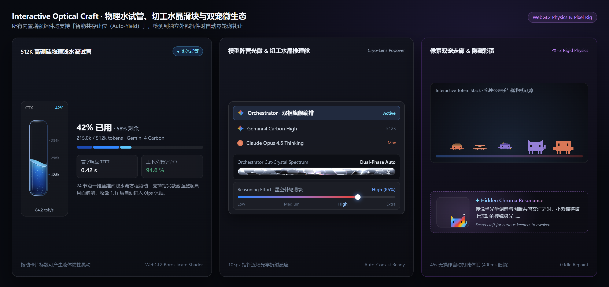
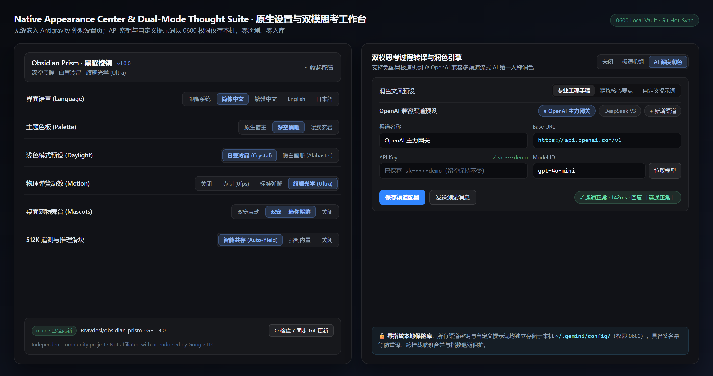

<div align="center">


# Obsidian Prism · 黑曜棱镜

**Optical UI, Spring Choreography & Dual-Mode Thought Suite for Antigravity**

为 Antigravity 打造的次世代光学视觉底座 · 四色深浅双态 · 二阶阻尼物理弹簧 · 512K 浅水波试管 · 双模思考流式润色

[**简体中文**](./README.md) · [**English**](./README.en.md) · [**下载安装包 (Releases)**](https://github.com/RMvdesi/obsidian-prism/releases) · [**问题反馈 (Issues)**](https://github.com/RMvdesi/obsidian-prism/issues)

<p>
  <a href="https://github.com/RMvdesi/obsidian-prism/releases"></a>
  
  <a href="https://github.com/RMvdesi/obsidian-prism/actions"></a>
  <a href="./LICENSE"></a>
  <a href="./NOTICE"></a>
</p>


</div>

> **非官方社区项目与商标免责声明 (Non-Affiliation Disclaimer)**
>
> **Obsidian Prism is an independent open-source project and is not affiliated with or endorsed by Google LLC.**
> 本项目为独立的开源社区工程，与 Google LLC 无任何隶属、赞助或官方背书关系；文中提及的 “Antigravity” 与 “Google” 仅作兼容性说明用途。

---

## ✨ 为什么选择 Obsidian Prism？

**Obsidian Prism** 在不破坏宿主任何核心业务功能与第三方插件的前提下，对 Antigravity 桌面端的色彩光学、帧率调度、遥测可视化与思考阅读体验进行了系统级重塑：

- **🎨 四套深浅光学矩阵**：内置 **深空黑曜 (`obsidian`)**、**暖炭玄岩 (`warm`)** 双深色与 **白昼冷晶 (`crystal`)**、**暖白画册 (`alabaster`)** 双浅色预设，自动跟随系统/宿主主题平滑切换。
- **⚡ GPU 合成器减负与真 `0fps` 静默休眠**：拔除常驻大面积 `backdrop-filter` 高斯模糊重采样；对话地平线极光采用 `32%` 视口裁剪 + `0.72x` 分辨率采样（GPU 占用 `< 0.4%`），窗口失焦或处于 `subtle` / `off` 档位时严格进入 **`0fps`** 休眠；流式吐字采用零节点拆分的纯 GPU 合成层动画，彻底告别长会话卡顿与跳帧。
- **🧪 512K 高硼硅物理浅水波试管 & 切工水晶推理滑块**：基于 24 节点圣维南浅水波方程实时渲染上下文水位与三段占比，配备 Orchestrator 切工钻石色散光谱条与推理等级滑块；支持**智能共存让位（Auto-Yield）**——检测到独立外部插件时自动零轮询礼让，绝不双开冲突。
- **🧠 内置双模思考转译与第一人称润色**：同时提供免配置的 **极速机翻** 与支持任意 **OpenAI 兼容接口的流式 AI 润色**（支持多渠道预设切换、`/v1/models` 在线拉取模型与连通测速）；所有密钥与自定义提示词以 **`0600` 权限**仅存本机，零遥测、零入库。
- **🦀 像素双宠微生态走廊**：红蟹 `Clawd` 与小紫猫在输入舱顶沿散步、抛物线跃障、最多 5 层拖拽叠叠乐，无操作自动打盹休眠。

---

## 🖼️ 视觉与核心交互画廊

### 1. 双深色 × 双白昼：四套高精度光学色板
无论是深夜低眩光编码，还是明亮环境下的高对比白昼阅读，每一套预设均配备独立调校的 WebGL2 二向色极光着色器与阴影层次：

<p align="center">
  
</p>

| 光学预设 | 配置键值 | 侧栏底色 | 主画布 | 视觉气质与适用场景 |
| :--- | :--- | :--- | :--- | :--- |
| **深空黑曜** | `palette: "obsidian"` | `#09090B` | `#0E0E11` | 冷冽暗晶深海 + 四色极光呼吸，适合高对比代码攻坚 |
| **暖炭玄岩** | `palette: "warm"` | `#10100F` | `#141413` | 温润深褐炭岩 + 琥珀暖金微光，适合夜间长文沉浸阅读 |
| **白昼冷晶** | `lightPreset: "crystal"` | `#E8EEF6` | `#F4F7FB` | 冰川冷瓷白 + 皇家钴蓝水墨极光 + 白瓷双层微投影 |
| **暖白画册** | `lightPreset: "alabaster"` | `#EBE6DC` | `#F6F4EE` | 砂岩亚麻纸感 + 宝石二向色水彩晕染，温润不刺眼 |

---

### 2. 物理浅水波试管 · 切工水晶推理条 · 双宠微生态
从可交互液面涟漪的 **512K 上下文水试管**、近场 105px 感应色散的 **Orchestrator 切工水晶条**，到支持刚体分离与叠罗汉物理的 **像素双宠走廊**（*至于角落里那抹披着流动彩虹极光的神秘身影……留待好奇的守护者自行探索唤醒*）：

<p align="center">
  
</p>

---

### 3. 原生外观控制面板 & 零指纹双模思考工作台
无缝嵌入 **Antigravity → 设置 (Settings) → 外观 (Appearance)**，支持简/繁/粤/英/日 5 语种实时切换、4 档物理弹簧动效调节、面板内一键检查并热同步最新 Git 提交，以及多渠道思考转译管理：

<p align="center">
  
</p>

---

## 🚀 快速安装指南 (Quick Start)

Obsidian Prism 提供 **「免环境图形安装器」** 与 **「原生插件一键部署」** 两种方式，刷新或重启客户端均自动常驻生效，随时可一键无痕还原：

### 方式一：图形化独立安装包（推荐普通用户，免装 Node.js）
前往 [**GitHub Releases**](https://github.com/RMvdesi/obsidian-prism/releases) 下载对应系统安装包：
1. **Windows**：运行 `obsidian-prism-installer.exe`，点击安装即可自动完成注入并注册静默开机守护（同一程序亦支持一键无痕卸载还原）。
2. **macOS (Apple Silicon & Intel Universal)**：挂载 `Obsidian-Prism-macOS-universal.dmg`，运行 `Obsidian Prism.app` 一键完成部署与 LaunchAgent 自启配置。

### 方式二：源码部署为 Antigravity 原生插件（推荐开发者，支持面板内一键拉取 Git 更新）
```bash
git clone https://github.com/RMvdesi/obsidian-prism.git
cd obsidian-prism

# 一键安装至 ~/.gemini/config/plugins/obsidian-prism 并热接管当前窗口
npm run install:plugin
```
安装完成后打开 **设置 (Settings) → 外观 (Appearance)**，即可展开 **「Obsidian Prism · 黑曜棱镜」** 面板自由定制。

<details>
<summary><strong>🛠️ 进阶命令行工具与项目目录结构（点击展开）</strong></summary>

#### 常用开发与维护命令
```bash
npm run inject           # 单次实时注入当前已打开的 Antigravity 窗口
npm run remove           # 无痕移除所有注入样式与组件，立即恢复原生界面
npm run clean:legacy     # 无损清理历史旧版 app.asar 遗留块（100% 保护汉化与外部插件）
npm test                 # 运行全量跨模块安全、性能与回归单测套件
npm run build:installer  # 自编译 Windows 独立安装器 (.exe)
npm run build:macos      # 自编译 macOS Universal 安装包 (.dmg)
```

#### 仓库核心目录结构
```text
obsidian-prism/
├── plugin.json                         # Antigravity 原生插件清单 (obsidian-prism@1.0.0)
├── LICENSE / NOTICE / CITATION.cff     # GPL-3.0 许可证、强制署名声明与仓库引用元数据
├── THIRD_PARTY_NOTICES.md              # 吸收整合的上游 MIT 项目完整版权与许可声明
├── assets/                             # 品牌真矢量图标与零隐私高清展示图
├── cdp.js / inject.js / remove.js      # 零依赖词法构建器、CDP 热接管与无痕还原协议
├── style.css                           # 黑曜/暖岩双深色 + 冷晶/暖白双浅色光学样式表
├── i18n-locales.js / i18n-core.js      # 简/繁/粤/英/日 5 语种多语言词条引擎
├── motion-engine.js / animated-icons.js# 4 档二阶阻尼谐振子弹簧引擎与 21 枚微动态图标
├── ripple-core.js / conv-aura.js       # WebGL2 地平线极光、四态会话流光与字符波纹矩阵
├── smooth-caret.js                     # FastDOM 读写分离零强制重排丝滑光标引擎
├── vial-core.js / pulse-vial-bridge.js # 512K 物理浅水波试管与遥测浮窗桥接器
├── dual-mascot-rig.js                  # 双宠微生态走廊、刚体分离与叠叠乐物理引擎
├── settings-panel.js / ui-runtime.js   # 可折叠设置中心与 FastDOM 双相增量同步核心
├── sidecars/daemon/                    # 原生无窗常驻守护 Sidecar (自动自愈、Git 同步桥、思考桥)
├── vendor/                             # 智能共存遥测兜底、推理滑块与双模思考转译模块
└── installer/ & tools/                 # Windows (C#) / macOS (Swift) 安装器与部署工具链
```
</details>

---

## ⚖️ 开源协议、二次开发强制规范与引用协议

### 1. 二次开发与分发协议 (`GPL-3.0` + `NOTICE`)
**Obsidian Prism**（`Copyright (C) 2026 RMvdesi`）采用 **[GNU General Public License v3.0 (`GPL-3.0-only`)](./LICENSE)** 开源发布，并附带基于 GPL-3.0 第 7 条的法定附加归属声明 **[`NOTICE`](./NOTICE)**。

基于本项目进行修改、二次开发、移植或打包再分发时，必须遵守以下三条规则：
1. **同源开源义务（Copyleft）**：任何包含或修改自本项目代码的衍生插件、主题包或安装程序，整体必须同样以 **`GPL-3.0`** 免费开放完整源代码，禁止闭源打包、混淆锁死或商业售卖。
2. **保留署名与致谢链（Attribution Required）**：必须在衍生仓库根目录完整保留 [`LICENSE`](./LICENSE)、[`NOTICE`](./NOTICE) 与 [`THIRD_PARTY_NOTICES.md`](./THIRD_PARTY_NOTICES.md)，并在 README 或设置界面醒目保留对原作者 `RMvdesi` 及原仓库 `RMvdesi/obsidian-prism` 的来源链接。
3. **标注修改记录与非官方背书（Mark Modifications）**：修改文件须注明修改日期与变更摘要；未经书面许可不得以 `Obsidian Prism` 官方原版名义发布衍生修改版。

#### 下游二次开发 README 标准致谢模板（可直接复制）
```markdown
> Built upon [Obsidian Prism](https://github.com/RMvdesi/obsidian-prism) by [@RMvdesi](https://github.com/RMvdesi), licensed under [GPL-3.0](https://www.gnu.org/licenses/gpl-3.0.html). Upstream component notices are preserved in `NOTICE` and `THIRD_PARTY_NOTICES.md`.
```

#### 论文 / 技术文章与衍生工程引用格式 (`CITATION.cff` / BibTeX)
亦可在仓库右上角点击 **“Cite this repository”** 一键复制引用卡片：
```bibtex
@software{rmvdesi_obsidian_prism_2026,
  author       = {RMvdesi},
  title        = {{Obsidian Prism: Optical UI, Spring Choreography & Dual-Mode Thought Suite for Antigravity}},
  year         = {2026},
  version      = {1.0.0},
  license      = {GPL-3.0-only},
  url          = {https://github.com/RMvdesi/obsidian-prism}
}
```

---

### 2. 上游开源项目与灵感致谢 (Upstream Credits)

本项目吸收整合的第三方组件原采用宽松的 **MIT License**（与 GPL-3.0 向上兼容），完整原始版权声明与许可全文均永久保留于 [`THIRD_PARTY_NOTICES.md`](./THIRD_PARTY_NOTICES.md)：

1. **[0DNANCY/agy-claude-style](https://github.com/0DNANCY/agy-claude-style)** — `MIT License`, `Copyright (c) 2026 0DNANCY`（主视觉光学底座、物理弹簧编排、WebGL2 极光/字符波纹矩阵、像素双宠底座与零依赖构建器）。
2. **[ATtacK030130/antigrative-dashboard](https://github.com/ATtacK030130/antigrative-dashboard)** — `MIT License`, `Copyright (c) 2026 AG Pulse contributors`（吸收于 `vendor/pulse-dashboard/`，实时吞吐速率、缓存命中率与配额遥测采集）。
3. **[LLYSH-HANNARI/antigravity-Codex-Claude-effort-slider](https://github.com/LLYSH-HANNARI/antigravity-Codex-Claude-effort-slider)** — `MIT License`, `Copyright (c) 2026 月上寒 (LLYSH-HANNARI)`（吸收于 `vendor/effort-slider/`，模型菜单推理等级滑块与智能共存封装）。
4. **[Nwflower/dsh-claude-style](https://github.com/Nwflower/dsh-claude-style)** — Studio 极简排版美学、清爽输入舱架构与温润画册配色灵感致谢。
5. **[Microqian2th/dsh-codex-effort-slider](https://github.com/Microqian2th/dsh-codex-effort-slider)** — 星尘能量轨道、迟滞棘轮分档与阻尼运动曲线灵感致谢。
6. **[mobius/dsh-performance-slider](https://github.com/mobius/dsh-performance-slider)** — 性能档位滑块交互范式与实时视觉反馈设计致谢。
7. **[claudenoshujin/claude-web](https://github.com/claudenoshujin/claude-web)** (by `lulu`) — *Mascot Pile & Micro-Ecology Interaction Inspiration*（桌面宠物叠叠乐与微生态交互灵感致谢；本项目物理引擎为净室独立实现）。
