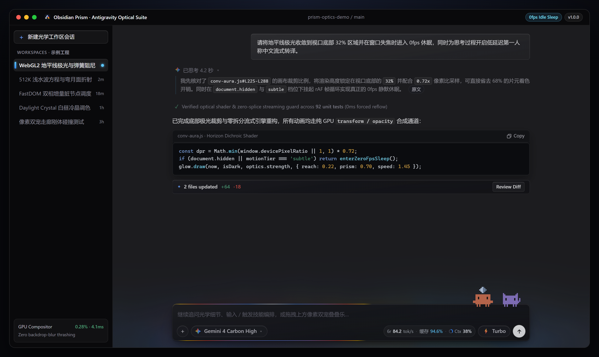

<div align="center">


# Obsidian Prism · 黑曜棱镜

**Modular Optical UI, Workbench Enhancements, Omni File Viewer, Quota Telemetry & Thought Translator for Antigravity**

Antigravity 桌面端主题与工作台增强套件 · 四套深浅配色 · 内置浏览器与全格式流式检视台 · 双窗口配额遥测 · 双模思考转译

[**简体中文**](./README.md) · [**English**](./README.en.md) · [**更新日志 (CHANGELOG)**](./CHANGELOG.md) · [**下载安装包 (Releases)**](https://github.com/RMvdesi/obsidian-prism/releases) · [**问题反馈 (Issues)**](https://github.com/RMvdesi/obsidian-prism/issues)

<p>
  <a href="https://github.com/RMvdesi/obsidian-prism/releases"></a>
  
  
  <a href="https://github.com/RMvdesi/obsidian-prism/actions"></a>
  <a href="./LICENSE"></a>
  <a href="./NOTICE"></a>
</p>



</div>

> **非官方社区项目与商标免责声明 (Non-Affiliation Disclaimer)**
>
> **Obsidian Prism is an independent open-source project and is not affiliated with or endorsed by Google LLC.**
> 本项目为独立的开源社区工程，与 Google LLC 无任何隶属、赞助或官方背书关系；文中提及的 “Antigravity” 与 “Google” 仅作兼容性说明用途。

---

## 核心特性

**Obsidian Prism (`v1.0.1`)** 在不改动宿主业务逻辑、不触碰外部插件锁文件的前提下，通过原生 Sidecar 插件架构为 Antigravity 桌面端提供界面配色、工作台交互增强、侧边栏内置浏览器与多格式流式检视台、模型配额遥测及思考过程转译：

- **四套深浅配色与细节微调**：内置深色（`obsidian` 深空黑曜、`warm` 暖炭玄岩）与浅色（`crystal` 白昼冷晶、`alabaster` 暖白画册）共四套主题，支持跟随系统/宿主亮暗切换；提供 5 档工业强调色（跟随模型 / 钴蓝 `cobalt` / 鸢尾紫 `iris` / 琥珀金 `amber` / 纯银钛单色 `mono`）、3 档全局圆角、4 档代码等宽字体与连字开关、环境光浓度调节。
- **300Hz 高刷分频与三态 `0fps` 语义余晖**：移除常驻大面积 `backdrop-filter` 模糊开销；在 300Hz 等高刷显示器下，推理稳态期背景极光自动限频至 `~30fps` 降低 GPU 占用，空闲 `1.2s` 后进入 `0fps` 休眠；支持「待用户决策 / 异常中止 / 长任务后台完成」三态无弹窗边缘余晖提示，静态定格后维持 `0fps` 零重绘，且不破坏宿主 React Fiber DOM 结构。
- **宿主深水区工作台适配**：通过宿主原生 `preload` 协议向 `plugin://*` Sidecar 面板（Swarm、Model Hub、Pulse 等）按需同步 24 项主题色彩变量，消除跨源 `iframe` 浅色闪白；Markdown 与 Artifacts 代码块顶栏支持 Sticky 吸顶，已完成且 `>= 48` 行的长代码块提供手动折叠/展开（不做自动截断，收起时自动补偿滚动位置）；左侧原生会话导轨支持长会话章节刻度、悬停提问大纲与关键词过滤、一键折叠历史步骤及非编辑焦点下 `Alt+↑` / `Alt+↓` 上下轮跳转；统一底部终端与后台任务卡片的控制台凹槽（Console Well）样式。
- **Omni 内置浏览器、右键菜单与全格式流式检视台**：支持开关控制（`omniModule: "on" | "off"`）与链接打开位置配置（`linkTarget: "builtin" | "external"`）。采用 `CSS.highlights`（Custom Highlight API）零 DOM 篡改激活对话与终端内的裸 URL、`localhost` 端口与本地文件路径，不拆分宿主 React 文本节点；默认左键网页链接在右侧内置浏览器打开（`Ctrl/Cmd+点击` 临时切换系统浏览器）。日常阅读保持**零悬停浮窗干扰**，仅在右键点击链接、文件药丸、Artifact 卡片或 Mermaid 图表时弹出操作菜单（复制绝对/相对路径、在文件夹中定位选中、作为 `@引用` 填入输入框、内外部浏览器打开、图表缩放）。侧边栏检视台基于仅监听 `127.0.0.1` 的 HTTP `206 Range` 流式网关，支持大体积视频逐帧检视、音频毫秒级波形打点、SVG/透明图棋盘格缩放画布（含 PNG 导出）、本地 HTML 响应式视口沙盒、PDF、`CSV/TSV/JSONL` 冻结表头检索与 `TTF/OTF/WOFF2` 字体样张预览。
- **纵深安全边界与本地隔离**：CDP 特权绑定（`__agPrism*`）强制校验顶层主 Frame 上下文，拒绝任何子 `<iframe>` 越权调用；本地流式网关实施 `Host` 与跨站请求校验、`realpath` 敏感凭据文件（`.env*`、`.ssh`、私钥证书与本地令牌配置等）双重拦截及远程 UNC 路径阻断；本地 HTML 预览采用 `HMAC-SHA256` 单目录作用域只读子令牌与受限 `sandbox` 隔离，思考转译上游请求禁用重定向并阻断云元数据与高危内网端口。
- **双窗口配额遥测与 512K 上下文指示**：遥测引擎对齐上游 [`ATtacK030130/antigrative-dashboard`](https://github.com/ATtacK030130/antigrative-dashboard) `v0.9.1`，支持全模型池 **5 小时 + 周度（Weekly）双窗口配额监控与线性耗尽预测**、**主会话与 Swarm/子代理 Token 消耗拆分**、**Cache 命中率**统计，以及基于 CDP 进程族谱的多实例归属识别；Studio 首页看板提供概览、趋势与模型配额三视图及按工作区筛选；遥测目录独立隔离，检测到外部独立插件时自动礼貌避让（Auto-Yield）。
- **双模思考转译工作台**：同时支持免配置**机器翻译**与 **OpenAI 兼容接口流式转译**，放行本地免密端点（`localhost` / 局域网 Ollama、LM Studio、vLLM 等无需填写 API Key）；基于 `file://` 协议白名单还原思考内容中的源码路径与 `#L` 行号点击跳转；内置服务端并发限流（上限 `3`）与视口优先调度队列、单块失败重试与强制重译，支持「沉浸纯译文 / 双语上下对照」切换及双端缓存清理；API Key 与提示词以 `0600` 权限仅保存在本机配置目录。
- **微内核模块化架构与毫秒级热刷新**：前端拆解为 `ui-runtime.js` 微内核与 6 个高内聚控制器模块，经 `cdp.js` 跨模块共享字符串池编译后静态主包体积 `< 680 KB`（Omni 客户端按独立双通道加载）；设置中心覆盖 26 项可校验配置键，内置三档场景预设、分类子标签页与自动剥离私钥凭据的脱敏 JSON 导入/导出备份，配置变更通过单飞增量广播在 `< 10 ms` 内热刷新生效。

---

## 界面与功能预览

### 1. 双深色 × 双浅色：四套配色方案
四套主题分别调校了侧栏与工作区明度层级、边框对比度与底部 WebGL2 着色器色温：

<p align="center">
  
</p>

| 主题预设 | 配置键值 | 侧栏底色 | 主画布 | 说明 |
| :--- | :--- | :--- | :--- | :--- |
| **深空黑曜** | `palette: "obsidian"` | `#09090B` | `#0E0E11` | 冷调深灰底色，高对比度代码阅读配色 |
| **暖炭玄岩** | `palette: "warm"` | `#10100F` | `#141413` | 暖炭褐底色，低蓝光夜间配色 |
| **白昼冷晶** | `lightPreset: "crystal"` | `#E8EEF6` | `#F4F7FB` | 冷调浅灰蓝侧栏与高明度工作区 |
| **暖白画册** | `lightPreset: "alabaster"` | `#EBE6DC` | `#F6F4EE` | 暖白纸色背景，柔和对比度浅色配色 |

---

### 2. 上下文水试管 · 推理等级滑块 · 桌面像素宠物
底部胶囊以 1D 浅水波实时指示 512K 上下文占用比例，悬停可展开上下文切片拆分与 5h/周配额预测浮窗；模型选择菜单内置推理等级滑块；输入框上方提供可独立开关的像素宠物（`Clawd` 与小猫，无操作自动休眠）：

<p align="center">
  
</p>

---

### 3. 外观控制中心与思考转译配置
集成至 **Antigravity → 设置 (Settings) → 外观 (Appearance)**，覆盖简/繁/粤/英/日 5 语种界面、26 项可校验配置键（含 `omniModule` 文件检视与右键菜单、`linkTarget` 网页链接默认打开位置）、三档场景预设（完整光效 / 专注编码 / 静默省电）、脱敏 JSON 备份恢复、面板内一键拉取 Git 更新，以及多渠道思考转译配置：

<p align="center">
  
</p>

---

## 快速安装指南 (Quick Start)

Obsidian Prism 提供 **「免环境图形安装包」** 与 **「源码部署原生插件」** 两种安装方式，刷新或重启客户端均自动生效，随时可无痕卸载还原：

### 方式一：图形化独立安装包（推荐普通用户，免装 Node.js）
前往 [**GitHub Releases**](https://github.com/RMvdesi/obsidian-prism/releases) 下载对应平台安装包：
1. **Windows (`.exe`)**：运行 `obsidian-prism-installer.exe`，安装器会优先将完整原生 Sidecar 插件树部署至 `~/.gemini/config/plugins/obsidian-prism`（覆盖配置、遥测、历史用量、Git 同步、思考转译与 Omni 检视通道），并注册后台热备守护进程（检测到原生 Sidecar Daemon 在线时自动礼貌避让，离线时无缝接管注入；同一程序亦支持一键卸载还原）。
2. **macOS (`Apple Silicon & Intel Universal`)**：挂载 `Obsidian-Prism-macOS-universal.dmg`，运行 `Obsidian Prism.app` 自动部署完整原生 Sidecar 插件并配置 `LaunchAgent` 热备守护。

### 方式二：源码部署为 Antigravity 原生插件（推荐开发者，支持面板内一键拉取 Git 更新）
```bash
git clone https://github.com/RMvdesi/obsidian-prism.git
cd obsidian-prism

# 部署至 ~/.gemini/config/plugins/obsidian-prism 并立即连接当前窗口
npm run install:plugin
```
安装完成后打开 **设置 (Settings) → 外观 (Appearance)**，展开 **「Obsidian Prism · 黑曜棱镜」** 区域即可调整各项参数。

<details>
<summary><strong>命令行维护工具与仓库目录结构（点击展开）</strong></summary>

#### 常用开发与维护命令
```bash
npm run inject           # 单次实时注入当前已打开的 Antigravity 窗口
npm run remove           # 移除全部注入样式与组件，立即恢复宿主原生界面
npm run clean:legacy     # 清理历史旧版 app.asar 遗留块（保留汉化与外部插件）
npm test                 # 运行跨模块安全、性能与回归测试套件
npm run build:installer  # 编译 Windows 独立安装器 (.exe)
npm run build:macos      # 编译 macOS Universal 安装包 (.dmg)
```

#### 仓库核心目录结构
```text
obsidian-prism/
├── plugin.json                         # Antigravity 原生插件清单 (obsidian-prism@1.0.1)
├── LICENSE / NOTICE / CITATION.cff     # GPL-3.0 许可证、附加署名声明与仓库引用元数据
├── THIRD_PARTY_NOTICES.md              # 吸收整合的上游 MIT 项目完整版权与许可声明
├── assets/                             # 插件矢量图标与说明文档截图资源
├── cdp.js / inject.js / remove.js      # 共享字符串池打包器 (<680KB)、双通道注入与卸载协议
├── style.css                           # 四套深浅主题、强调色/圆角变量与宿主表面样式表
├── i18n-locales.js / i18n-core.js      # 简/繁/粤/英/日 5 语种多语言词条模块
├── motion-engine.js / animated-icons.js# 4 档二阶阻尼弹簧动画与微动态图标模块
├── ripple-core.js / conv-aura.js       # 300Hz 分频 WebGL2 地平线着色器与三态 0fps 语义余晖
├── smooth-caret.js / dual-mascot-rig.js# 读写分离编辑器光标跟随与桌面像素双宠模块
├── usage-core.js / vial-core.js        # 用量统计/双窗口配额预测纯函数与 512K 浅水波胶囊
├── pulse-vial-bridge.js                # 上下文切片拆分与 5h/周配额浮窗桥接器
├── settings-panel.js                   # 外观设置中心（26 项配置、场景预设、脱敏 JSON 备份）
├── home-studio-panel.js                # 控制器 1：Studio 新建会话看板（概览/趋势/配额三视图）
├── home-ripple-host.js                 # 控制器 2：首页字符波纹矩阵宿主控制器
├── model-glyph-crystal.js              # 控制器 3：模型星标与 WebGL2 棱镜状态栏控制器
├── stream-choreography.js              # 控制器 4：流式输出分块过渡与表格行级防抖控制器
├── prism-rim-canvas.js                 # 控制器 5：近场指针边框高光控制器
├── host-workbench-enhancer.js          # 控制器 6：Sidecar 主题同步桥、代码折叠与导轨大纲控制器
├── ui-runtime.js                       # 前端微内核：配置热同步、DOM 观察器与生命周期编排
├── sidecars/daemon/                    # 多通道常驻守护进程 (设置/遥测/用量/Git/思考/Omni流式网关)
├── vendor/                             # 遥测 (v0.9.1)、滑块、思考转译与 omni-viewer 流式检视台
└── installer/ & tools/                 # Windows (C#) / macOS (Swift) 原生插件安装器与工具链
```
</details>

---

## 开源协议、二次开发规范与引用格式

### 1. 二次开发与分发协议 (`GPL-3.0-only` + `NOTICE`)
**Obsidian Prism**（`Copyright (C) 2026 RMvdesi`）采用 **[GNU General Public License v3.0 (`GPL-3.0-only`)](./LICENSE)** 开源发布，并附带基于 GPL-3.0 第 7 条的法定附加归属声明 **[`NOTICE`](./NOTICE)**。

基于本项目进行修改、二次开发、移植或打包再分发时，须遵守以下三项要求：
1. **同源开源义务（Copyleft）**：任何包含或修改自本项目代码的衍生插件、主题包或安装程序，整体须同样以 **`GPL-3.0`** 免费开放完整对应源代码，禁止闭源打包、代码混淆锁死或商业闭源售卖。
2. **保留署名与致谢链（Attribution Required）**：须在衍生仓库根目录完整保留 [`LICENSE`](./LICENSE)、[`NOTICE`](./NOTICE) 与 [`THIRD_PARTY_NOTICES.md`](./THIRD_PARTY_NOTICES.md)，并在 README 或设置界面保留对原作者 `RMvdesi` 及原仓库 `RMvdesi/obsidian-prism` 的来源链接。
3. **标注修改记录与非官方背书（Mark Modifications）**：修改过的文件须注明修改日期与变更摘要；未经书面许可不得以未修改的 `Obsidian Prism` 官方原版名义发布衍生版本。

#### 下游二次开发 README 署名模板
```markdown
> Built upon [Obsidian Prism](https://github.com/RMvdesi/obsidian-prism) by [@RMvdesi](https://github.com/RMvdesi), licensed under [GPL-3.0](https://www.gnu.org/licenses/gpl-3.0.html). Upstream component notices are preserved in `NOTICE` and `THIRD_PARTY_NOTICES.md`.
```

#### 引用格式 (`CITATION.cff` / BibTeX)
```bibtex
@software{rmvdesi_obsidian_prism_2026,
  author       = {RMvdesi},
  title        = {{Obsidian Prism: Modular Optical UI, Workbench Enhancements, Omni File Viewer, Quota Telemetry & Thought Translator for Antigravity}},
  year         = {2026},
  version      = {1.0.1},
  license      = {GPL-3.0-only},
  url          = {https://github.com/RMvdesi/obsidian-prism}
}
```

---

### 2. 上游开源项目与致谢 (Upstream Credits)

本项目吸收适配的第三方组件原采用 **MIT License**（与 `GPL-3.0-only` 兼容），完整原始版权声明与许可全文保留于 [`THIRD_PARTY_NOTICES.md`](./THIRD_PARTY_NOTICES.md)：

1. **[0DNANCY/agy-claude-style](https://github.com/0DNANCY/agy-claude-style)** — `MIT License`, `Copyright (c) 2026 0DNANCY`（基础配色框架、弹簧动画底座、WebGL2 地平线/字符波纹矩阵、像素宠物底座与打包器雏形）。
2. **[ATtacK030130/antigrative-dashboard](https://github.com/ATtacK030130/antigrative-dashboard)** (`v0.9.1`) — `MIT License`, `Copyright (c) 2026 AG Pulse contributors`（吸收适配于 `vendor/pulse-dashboard/`，用于实时吞吐速率、Cache 命中率、5h/周双窗口模型配额预测、主/子代理消耗拆分与多实例进程血缘归属）。
3. **[LLYSH-HANNARI/antigravity-Codex-Claude-effort-slider](https://github.com/LLYSH-HANNARI/antigravity-Codex-Claude-effort-slider)** — `MIT License`, `Copyright (c) 2026 月上寒 (LLYSH-HANNARI)`（吸收适配于 `vendor/effort-slider/`，用于模型菜单推理等级滑块与智能共存让位）。
4. **[Nwflower/dsh-claude-style](https://github.com/Nwflower/dsh-claude-style)** — Studio 极简排版、输入框边框结构与暖白浅色配色参考致谢。
5. **[Microqian2th/dsh-codex-effort-slider](https://github.com/Microqian2th/dsh-codex-effort-slider)** — 轨道刻度分档、迟滞吸附与阻尼运动曲线参考致谢。
6. **[mobius/dsh-performance-slider](https://github.com/mobius/dsh-performance-slider)** — 性能档位滑块交互与实时反馈设计参考致谢。
7. **[claudenoshujin/claude-web](https://github.com/claudenoshujin/claude-web)** (by `lulu`) — 桌面宠物堆叠交互设计参考致谢（本项目物理逻辑为净室独立实现）。
